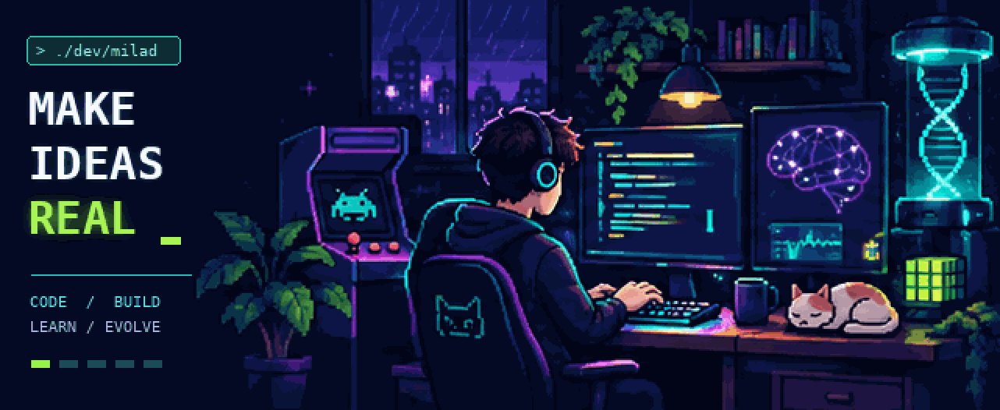
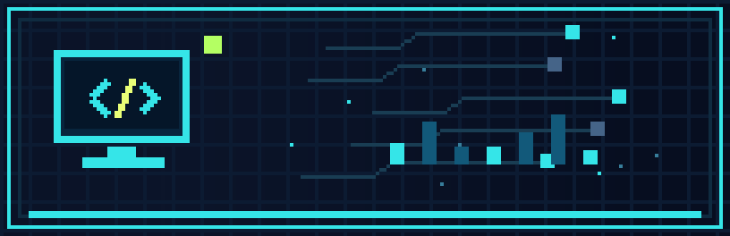
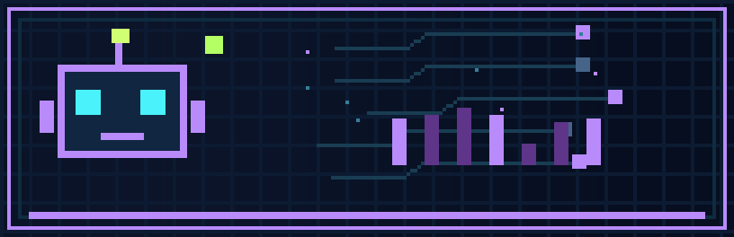
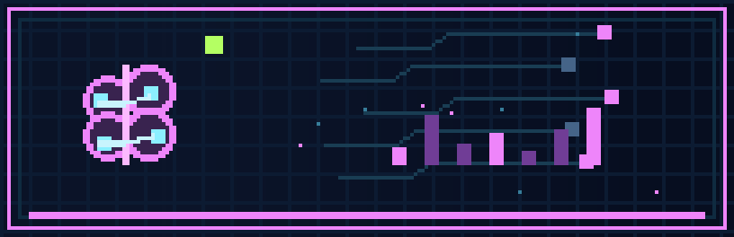
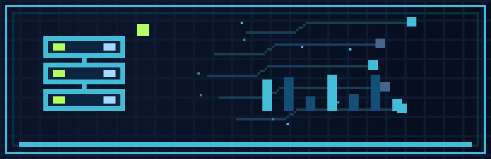
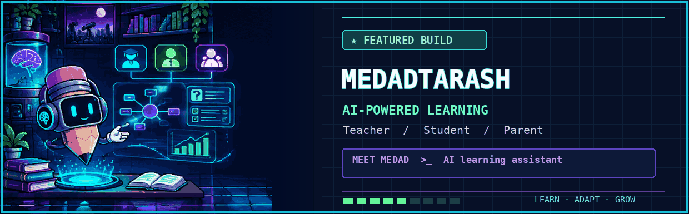
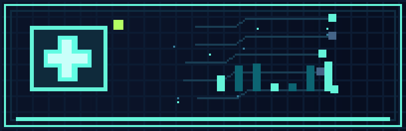
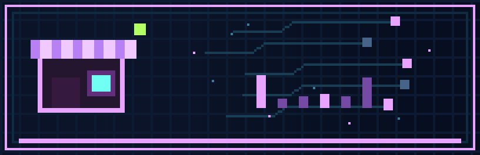

<!-- HERO: pixel arcade animation (unchanged) -->

<!-- Animated terminal -->

 

---

## `> whoami` · 👾 Player profile

<table>
<tr>
<td width="34%" align="center" valign="middle">
   
  <code>PLAYER 01 · MILAD</code>
</td>
<td width="66%" valign="middle">
  <h3>Hey, I'm Milad Anvari! 👋</h3>
  
I'm a <strong>Computer Engineering student at Urmia University</strong> who enjoys finding out <em>why things work</em>, not just getting them to run.

  
I build practical software across <strong>full-stack development, backend systems, automation and AI</strong>. From a rough idea to a working product, I enjoy the experiments, mistakes and improvements along the way.

  
I'm especially curious about how we build intelligent systems — and how people and brains learn.

  <code>learn() → experiment() → build() → improve()</code>
</td>
</tr>
</table>

## `01 / things I build` · 🕹️ Select a stage

<table>
<tr>
<td width="50%" valign="top">
   
  <strong>🌐 Web apps & backend systems</strong>  
  Building user-facing applications, APIs, and database-backed services that go beyond a prototype.
</td>
<td width="50%" valign="top">
   
  <strong>🤖 Bots & automation</strong>  
  Creating tools that remove repetitive work and make everyday digital experiences smoother.
</td>
</tr>
<tr>
<td width="50%" valign="top">
   
  <strong>🧠 AI-powered experiences</strong>  
  Exploring intelligent, adaptive applications — especially where technology and learning intersect.
</td>
<td width="50%" valign="top">
   
  <strong>⚙️ Systems & deployment</strong>  
  Taking applications from local development to running services, databases, and Linux infrastructure.
</td>
</tr>
</table>

## `02 / featured build` · ⭐ Main Quest

<table>
<tr>
<td width="100%" valign="top">
  <h3>🎓 MedadTarash — AI-Powered Learning Platform</h3>
  
<strong>More than a classroom management system.</strong> MedadTarash is an intelligent educational platform designed around how people actually learn. It connects <strong>students, teachers, and parents</strong> and introduces <strong>Medad</strong>, an AI learning assistant.

  
Built around <strong>learning analysis</strong>, <strong>AI-assisted question generation</strong>, and <strong>personalized exercises</strong>, the platform aims to make learning more adaptive, meaningful, and accessible.

  
<code>AI in education</code> · <code>Learning analytics</code> · <code>Question generation</code> · <code>Personalized practice</code>

</td>
</tr>
</table>

## `03 / beyond the code` · 🧩 Side quests

<table>
<tr>
<td width="50%" valign="top">
   
  <strong>🏥 IT · Medical team</strong>  
  I'm responsible for IT and technical support within a medical team, helping its digital tools and day-to-day workflows run reliably.
</td>
<td width="50%" valign="top">
   
  <strong>🛍️ MILINK · Online shop</strong>  
  I run <strong>MILINK</strong>, my own online shop — combining technology, operations, customer experience, and automation.
</td>
</tr>
</table>

## `04 / learning in progress` · 🧠 Neural Lab

<!-- Original Neural Lab animation preserved -->

**At university, I'm studying:**

- 🧩 **Operating Systems** — processes, threads, synchronization, and memory management.
- 🗃️ **Database Systems** — SQL, relational models, and query design.
- 📐 **Design & Analysis of Algorithms** — algorithmic thinking, correctness, and complexity.
- 🤖 **Artificial Intelligence** — intelligent agents, search, and reasoning.

**Outside class, I keep exploring:**

- **Conceptual model training** — how AI models acquire, represent, and reason about concepts.
- **Computational neuroscience & brain-inspired AI** — what studying the brain can teach us about learning and intelligence.
- **Practical machine learning** — connecting ideas from theory with real experiments.

## `05 / my everyday toolkit` · 🛠️ Inventory

**Languages & application development**

  

**Data, infrastructure & tools**

---

### `> while (curious) { learn(); build(); repeat(); }`

🎮 GAME STATE: learning in progress • next level loading...

  

