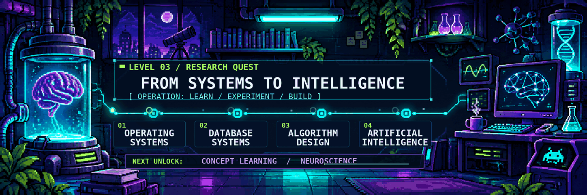

<!-- PIXEL ARCADE + NEURAL LAB: looping GIF hosted in this repository -->

<!-- LOOPING TERMINAL TYPING — external SVG service -->

 

---

## `> whoami`

Hey! I'm **Milad Anvari**, a **Computer Engineering student at Urmia University**.

I like figuring out **why systems work**, not just getting them to run. I'm happiest when I'm turning an idea into something real: a useful product, a smarter workflow, or a system that solves an actual problem.

My work usually lives somewhere between **full-stack development, backend engineering, automation, and AI**. I enjoy building things, breaking them, learning from them, and making the next version better.

> **My approach:** understand deeply → build practically → keep improving.

## `01 / things I build`

<table>
  <tr>
    <td width="50%" valign="top">
      <strong>🌐 Web apps & backend systems</strong>  
      Building user-facing applications, APIs, and database-backed services that go beyond a prototype.
    </td>
    <td width="50%" valign="top">
      <strong>🤖 Bots & automation</strong>  
      Creating tools that remove repetitive work and make everyday digital experiences smoother.
    </td>
  </tr>
  <tr>
    <td width="50%" valign="top">
      <strong>🧠 AI-powered experiences</strong>  
      Exploring intelligent, adaptive applications — especially where technology and learning intersect.
    </td>
    <td width="50%" valign="top">
      <strong>⚙️ Systems & deployment</strong>  
      Taking applications from local development to running services, databases, and Linux infrastructure.
    </td>
  </tr>
</table>

## `02 / beyond the code`

<table>
  <tr>
    <td width="50%" valign="top">
      <strong>🏥 IT · Medical team</strong>  
      I'm responsible for IT and technical support within a medical team, helping its digital tools and day-to-day workflows run reliably.
    </td>
    <td width="50%" valign="top">
      <strong>🛍️ MILINK · Online shop</strong>  
      I run <strong>MILINK</strong>, my own online shop — combining technology, operations, customer experience, and automation.
    </td>
  </tr>
</table>

## `03 / learning in progress`

<!-- NEURAL LAB: pulsing research skill tree — loops continuously -->

**At university, I'm studying:**

- 🧩 **Operating Systems** — processes, threads, synchronization, and memory management.
- 🗃️ **Database Systems** — SQL, relational models, and query design.
- 📐 **Design & Analysis of Algorithms** — algorithmic thinking, correctness, and complexity.
- 🤖 **Artificial Intelligence** — intelligent agents, search, and reasoning.

**Outside class, I keep exploring:**

- **Conceptual model training** — how AI models acquire, represent, and reason about concepts.
- **Computational neuroscience & brain-inspired AI** — what studying the brain can teach us about learning and intelligence.
- **Practical machine learning** — connecting ideas from theory with real experiments.

## `04 / my everyday toolkit`

**Languages & application development**

  

**Data, infrastructure & tools**

---

### `> while (curious) { learn(); build(); repeat(); }`

🎮 GAME STATE: learning in progress • next level loading...

  

