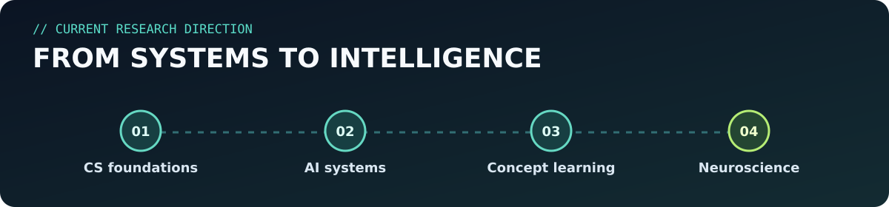

 

## `> whoami` 

I'm **Milad Anvari**, a Computer Engineering student at **Urmia University**.

I like finding out **why something works**, not just how to make it run. My favorite part of software engineering is turning a messy idea into a real, usable product — and learning a few new things along the way.

I spend most of my time somewhere between **full-stack development**, **backend systems**, **automation**, and **AI**. I'm especially drawn to the overlap between how we build intelligent systems and how humans actually learn.

---

## `01 / things I've built`

Here are some of the things I enjoy building and improving:

<table>
<tr>
<td width="50%" valign="top">
<strong>🌐 Web products & APIs</strong>  
Interfaces, backend services and databases that turn an idea into something people can actually use.
</td>
<td width="50%" valign="top">
<strong>🤖 Automation & bots</strong>  
Practical tools that streamline repetitive work and connect people to digital services.
</td>
</tr>
<tr>
<td width="50%" valign="top">
<strong>🧠 AI in education</strong>  
Experiments with adaptive learning, personalized practice and AI-assisted experiences.
</td>
<td width="50%" valign="top">
<strong>🛠️ Deployment & infrastructure</strong>  
Moving applications beyond localhost: Linux, databases, services and production setup.
</td>
</tr>
</table>

## `02 / off the keyboard, on the job`

<table>
<tr>
<td width="50%" valign="top">
<strong>🏥 IT · Medical team</strong>  
I handle IT responsibilities for a medical team, supporting the technical side of its day-to-day work and digital tools.
</td>
<td width="50%" valign="top">
<strong>🛍️ MILINK · Online shop</strong>  
I run <strong>MILINK</strong>, my own online shop — a hands-on mix of business operations, customer experience and automation.
</td>
</tr>
</table>

## `03 / what I'm learning right now`

**This semester** I'm deepening my foundations in:

`Operating Systems` &nbsp; · &nbsp; `Database Systems` &nbsp; · &nbsp; `Design & Analysis of Algorithms` &nbsp; · &nbsp; `Artificial Intelligence`

**Beyond coursework**, two questions keep pulling me in:

- **How do models learn concepts?** I'm exploring the training of models for conceptual understanding and better representations.
- **What can AI learn from the brain?** I'm studying **neuroscience, computational neuroscience**, and brain-inspired approaches to learning and intelligence.

## `04 / tools I reach for`

---

<code>while (curiosity) { learn(); experiment(); build(); }</code>

  

Thanks for stopping by. The good stuff is still being built.

